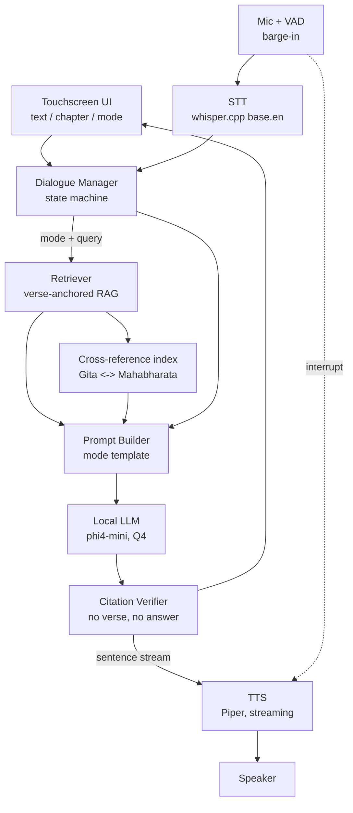

# Shastra Samvad — Architecture Diagram

One spoken turn, start to finish. Everything below runs on-device — no
network call anywhere in the pipeline. Target hardware: Jetson Orin Nano.

> This diagram renders natively on GitHub. If your viewer doesn't render
> Mermaid, open [`docs/architecture.html`](docs/architecture.html) instead
> (download it and open in a browser — GitHub serves raw HTML as plain text,
> it won't render inline on github.com).

## Stages

| Stage | Does | Runs as |
|---|---|---|
| STT | Speech to text, English only | faster-whisper (dev) / whisper.cpp (device) |
| Dialogue Manager | Classifies the turn — Teach / Doubt / Debate / Counsel — tracks lesson state | rule phrases + embedding similarity |
| Retriever | Top-k verses for the query, strategy varies per mode | bge-small-en-v1.5 + FAISS |
| Cross-reference | Links a Gita verse to its illustrating Mahabharata passage | precomputed cosine map, ≥0.80 |
| Prompt Builder | Assembles persona + mode instruction + verses + history | template per mode |
| LLM | Generates the answer, streaming | phi4-mini, Q4_K_M GGUF, llama.cpp |
| Citation Verifier | Withholds any sentence not grounded in a retrieved verse | cosine gate + NLI contradiction check |
| TTS | Speaks each verified sentence as it clears | Piper, streaming |

## Hardware (Jetson Orin Nano build)

- Jetson Orin Nano Developer Kit (8GB) — college-provided, with its own 19 V supply and heatsink + fan
- 64 GB microSD UHS-I A2 (boot storage; an M.2 NVMe SSD is optional)
- 7" Waveshare capacitive touchscreen (HDMI video + USB touch), driven through a DisplayPort-to-HDMI adapter
- Waveshare USB Audio Codec (mic in, 3.5 mm out)
- 3 W self-powered speaker (or passive speaker + PAM8403 amp)
- Optional portable power: 19 V DC-output power bank rated 45 W or more

Full detail: [`software_architecture.md`](software_architecture.md) ·
[`README.md`](README.md) · [`backend/config.py`](backend/config.py)
